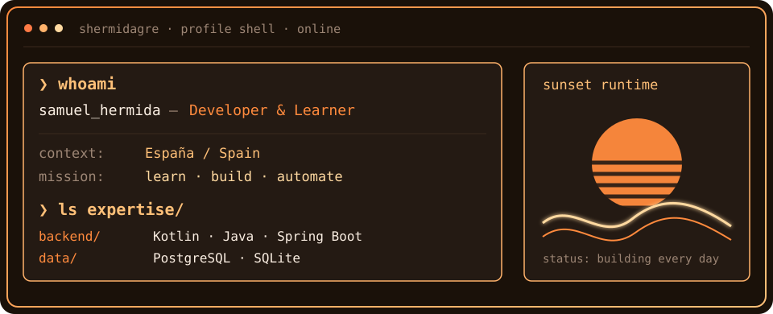

<!-- ANIMATED BANNER -->
<a href="https://github.com/shermidagre">
  <picture>
    <source media="(prefers-color-scheme: dark)" srcset="assets/banner-dark.svg">
    <source media="(prefers-color-scheme: light)" srcset="assets/banner-light.svg">
    
  </picture>
</a>

 

---

## `$ whoami`

  

 

## `$ cat about.md`

🇬🇧 **EN** — Software developer from Spain. I recently finished my **DAM** (Multiplatform Application Development) studies and my time in Dublin. Right now I keep learning autonomously with one clear goal: becoming a **Full Stack developer specialised in AI and automation**.

🇪🇸 **ES** — Desarrollador de software español. Terminé mis estudios de **DAM** (Desarrollo de Aplicaciones Multiplataforma) y mi etapa en Dublín. Ahora sigo aprendiendo en autonomía con un objetivo claro: convertirme en **desarrollador Full Stack especializado en IA y automatización**.

I believe software should be:

- ✅ **Clear** — easy to read, even months later
- ✅ **Reliable** — well tested and documented
- ✅ **Purposeful** — solving real problems, not just writing code

 

## `$ cat tech-stack.yaml`

<table border="1" cellpadding="14" bgcolor="#1A1109">
  <thead>
    <tr>
      <th colspan="2" align="left"><code>shermidagre:~$ cat tech-stack.yaml</code></th>
    </tr>
  </thead>
  <tbody>
    <tr>
      <td width="50%" valign="top"><code>├─ ☕ languages:</code>  
         
        <code>Kotlin · Java · Python · JavaScript · HTML · CSS</code>
      </td>
      <td width="50%" valign="top"><code>├─ ⚙ backend_apis:</code>  
         
        <code>Spring Boot · Swagger · Docker</code>
      </td>
    </tr>
    <tr>
      <td valign="top"><code>├─ ▣ databases:</code>  
         
        <code>PostgreSQL · SQLite</code>
      </td>
      <td valign="top"><code>╰─ ✓ tools_os:</code>  
         
        <code>Git · Linux · Postman</code>
      </td>
    </tr>
  </tbody>
  <tfoot>
    <tr>
      <td colspan="2"><code>status: building&nbsp;&nbsp;·&nbsp;&nbsp;mode: learning</code></td>
    </tr>
  </tfoot>
</table>

---

## `$ ./skills --report`

  <picture>
    <source media="(prefers-color-scheme: dark)" srcset="assets/radar-dark.svg">
    <source media="(prefers-color-scheme: light)" srcset="assets/radar-light.svg">
    
  </picture>&nbsp;
  <picture>
    <source media="(prefers-color-scheme: dark)" srcset="assets/radar-langs-dark.svg">
    <source media="(prefers-color-scheme: light)" srcset="assets/radar-langs-light.svg">
    
  </picture>

<code>signals: skill_radar · language_stack · status: growing</code>

---

## `$ cat learning.md`

- 🤖 **AI Integration & Automation** — build smarter workflows
- ✨ **Spring Boot best practices** — security, validation, error handling
- 🐳 **Docker** — consistent, reproducible deployments
- 🌐 **RESTful API design** — following industry standards

---

## `$ connect --socials`

&nbsp;&nbsp;
&nbsp;&nbsp;

 
 

Hecho con 🧡 desde España · Made with 🧡 from Spain · @shermidagre

